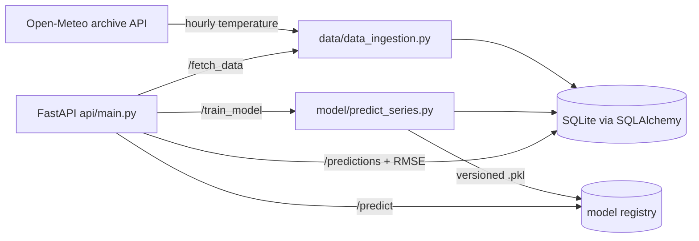

# Weather Time-Series Forecasting API

A FastAPI service that ingests historical weather data, trains forecasting models on demand and serves predictions with their error against observed values.

**Result:** R² = 97% on the temperature forecasting task (Random Forest regressor on engineered time features).

## Why

Forecasting models usually live in notebooks. This project wraps the full lifecycle (data ingestion, training, versioned model registry, prediction, evaluation) behind a REST API, so a model can be retrained and compared from any client.

## Architecture



- `data/`: ingestion from the [Open-Meteo](https://open-meteo.com/) archive API and SQLAlchemy models (`Model`, `RealTemperature`, `Prediction`).
- `model/`: feature engineering (calendar and lag features), training and prediction pipeline. Each trained model is saved with a version in the registry.
- `api/`: FastAPI endpoints, plus unit and integration tests in `api/tests/`.
- `notebooks/time_series.ipynb`: exploration and model selection.

## Run it

```bash
git clone https://github.com/lucgmensah/weather-forecasting-api.git
cd weather-forecasting-api
docker build -t weather-forecasting-api .
docker run -p 8000:8000 weather-forecasting-api
```

Interactive documentation: <http://localhost:8000/docs>

Without Docker:

```bash
pip install -r requirements.txt
uvicorn api.main:app --reload
```

## API

| Method | Endpoint | Purpose |
|---|---|---|
| POST | `/fetch_data` | Download and store hourly temperatures for a date range |
| POST | `/train_model` | Train and register a new model version on a date range |
| GET | `/models` | List registered models |
| POST | `/predict` | Generate predictions with a given model |
| POST | `/predictions` | Return stored predictions with their RMSE |

```bash
curl -X POST http://localhost:8000/fetch_data -H "Content-Type: application/json" \
  -d '{"start_date": "2022-01-01", "end_date": "2024-12-31"}'

curl -X POST http://localhost:8000/train_model -H "Content-Type: application/json" \
  -d '{"version": "1.0.0", "start_date": "2022-01-01", "end_date": "2024-12-31"}'

curl -X POST http://localhost:8000/predict -H "Content-Type: application/json" \
  -d '{"model_id": 1, "start_date": "2025-01-01", "end_date": "2025-01-31"}'
```

## CI/CD

GitHub Actions (`.github/workflows/pipeline.yml`): lint (flake8, black), tests (pytest), versioning from the commit hash, then a Docker image pushed to GitHub Container Registry with a version tag and `latest`.

## Stack

Python, FastAPI, scikit-learn, pandas, SQLAlchemy, SQLite, Docker, GitHub Actions.

---

Final project of the MSc Big Data & AI (BIHAR), ESTIA, 2024-2025. Previously part of `final_projet_lucg`. MIT licence.
